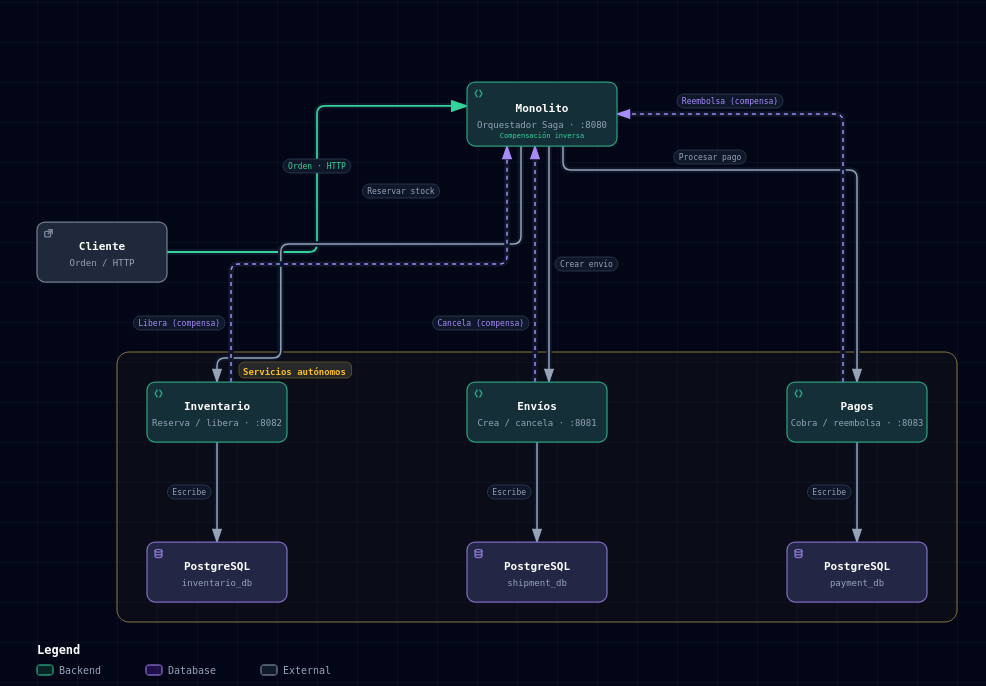

<p align="center">
  <a href="#descripción">
    
  </a>
  <div>
    <span style="font-size: 2rem; font-weight: bold; color: #333;">Axiom Flow</span><br>
    <span style="color: #666; font-size: 1rem;">Orquestación de transacciones distribuidas con el patrón Saga</span>
  </div>
</p>

<p align="center">
  <a href="#descripción"><kbd>Descripción</kbd></a>&nbsp;&nbsp;|&nbsp;&nbsp;
  <a href="#arquitectura"><kbd>Arquitectura</kbd></a>&nbsp;&nbsp;|&nbsp;&nbsp;
  <a href="#stack-tecnológico"><kbd>Stack tecnológico</kbd></a>&nbsp;&nbsp;|&nbsp;&nbsp;
  <a href="#api-documentada"><kbd>API Documentada</kbd></a>&nbsp;&nbsp;|&nbsp;&nbsp;
  <a href="#cómo-ejecutar"><kbd>Cómo ejecutar</kbd></a>&nbsp;&nbsp;|&nbsp;&nbsp;
  <a href="#variables-de-entorno"><kbd>Variables de entorno</kbd></a>&nbsp;&nbsp;|&nbsp;&nbsp;
  <a href="#licencia"><kbd>Licencia</kbd></a>
</p>

<hr>

## Descripción

Axiom Flow procesa pedidos mediante una Saga orquestada: cada orden atraviesa los pasos de pago, reserva de inventario y envío. Si alguno falla, el orquestador ejecuta compensaciones en orden inverso (liberar inventario, reembolsar pago, cancelar envío) para mantener la consistencia del sistema.

Cada microservicio es autónomo y posee su propia base de datos PostgreSQL, eliminando acoplamiento a nivel de datos y permitiendo extracción independiente en el futuro.

---

## Arquitectura

<p align="center">
  
</p>

---

## Decisiones de diseño y consistencia

Las protecciones de consistencia implementadas (transacciones atómicas, `SELECT FOR UPDATE`, `idempotency_key` con constraint `UNIQUE`, patrón Outbox y circuit breaker) están documentadas en detalle en [`architectural_decisions/README.md`](architectural_decisions/README.md#4-protecciones-transaccionales-y-de-consistencia).

---

## Stack tecnológico

- **Lenguaje:** Go 1.27
- **Base de datos:** PostgreSQL (una por servicio)
- **Monolito HTTP:** Gin
- **Microservicios:** `net/http` estándar
- **Driver SQL:** `lib/pq`, `sqlx`
- **Variables de entorno:** `godotenv`
- **Contenedores:** Docker

---

## API Documentada

Cada servicio expone Swagger UI listo para explorar sin instalar nada:

| Servicio | Puerto | Swagger UI |
|----------|--------|------------|
| Monolito (órdenes + Saga) | 8080 | `http://localhost:8080/docs` |
| Inventario | 8082 | `http://localhost:8082/docs` |
| Envíos | 8081 | `http://localhost:8081/docs` |

La especificación OpenAPI 3.0 completa está en `api/openapi.yaml` y puede importarse en Postman, Insomnia o Swagger Editor.

---

## Cómo ejecutar

Usando Docker Compose (recomendado):

```bash
# Clonar el repositorio
git clone https://github.com/jara505/axiom-flow.git
cd axiom-flow

# Copiar y configurar variables de entorno
cp .env.example .env
# Editar .env con tus credenciales de PostgreSQL

# Levantar todos los servicios (PostgreSQL, Redis, microservicios y monolito)
docker-compose up -d
```

Los servicios se iniciarán en los siguientes puertos:
- **Monolito (órdenes + Saga):** puerto 8080
- **Servicio de envíos:** puerto 8081
- **Servicio de inventario:** puerto 8082
- **Servicio de pagos:** puerto 8083

Para ver los logs de todos los servicios:
```bash
docker-compose logs -f
```

Para detener todos los servicios:
```bash
docker-compose down
```

### Desarrollo local sin Docker (solo para desarrollo):

Si prefieres ejecutar los servicios directamente sin Docker:

```bash
# 1. Levantar PostgreSQL localmente (o usar el que ya tengas)
# Los servicios esperan las variables DB_HOST, DB_PORT, DB_USER, DB_PASSWORD, DB_NAME

# 2. Levantar Redis localmente
redis-server --daemonize yes

# 3. Ejecutar el monolito
go run ./cmd/server/

# 4. En terminales separadas, ejecutar microservicios:
go run ./services/inventory/main.go   # puerto 8082
go run ./services/shipment/main.go    # puerto 8081
go run ./services/payment/main.go     # puerto 8083
```

Cada servicio inicializa su esquema automáticamente al arrancar (`initSchema`), por lo que no es necesario aplicar migraciones manuales en primera ejecución.

---

## Variables de entorno

| Variable | Descripción | Valor por defecto |
|----------|-------------|-------------------|
| `PORT` / `APP_PORT` | Puerto del servicio | 8080 / 8081 / 8082 |
| `DB_HOST` | Host de PostgreSQL | `localhost` |
| `DB_PORT` | Puerto de PostgreSQL | `5432` |
| `DB_USER` | Usuario de PostgreSQL | `postgres` |
| `DB_PASSWORD` | Contraseña de PostgreSQL | `postgres` |
| `DB_NAME` | Nombre de la base de datos | `axiom_flow` |
| `DB_SSL_MODE` | Modo SSL de PostgreSQL | `disable` |
| `PAYMENT_SERVICE_URL` | URL del servicio de pago | `http://localhost:8083` |
| `SHIPMENT_REMOTE_URL` | URL del servicio de envíos | `http://localhost:8081` |
| `INVENTORY_REMOTE_URL` | URL del servicio de inventario | `http://localhost:8082` |

Consulta `.env.example` para la plantilla completa.

---

## Licencia

Copyright (c) 2026. Todos los derechos reservados. Este software es de propiedad privada. No se concede licencia para uso, copia, modificación o distribución sin autorización explícita por escrito del autor.