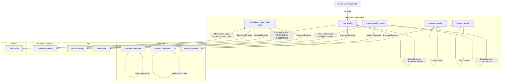

# Escenarios (casos de uso + fallos)

## Escenarios con posibles fallos ante un caso de uso

### Creación de pedido

- El pedido se crea, pero los datos almacenados en la base de datos no concuerdan con los datos del pedido creado.
- El pedido falla durante su creación y la base de datos queda en un estado inconsistente. Esto también puede ocurrir debido a una falla del usuario, como una pérdida de conexión durante la operación.
- El mismo pedido puede ser creado o replicado múltiples veces.
- El pedido entregado no concuerda con el producto que fue solicitado.

### Procesamiento de pago

- El pago se realiza de forma duplicada y el sistema no reporta la duplicación ni ejecuta ninguna medida ante esta situación.
- Se produce un error en los servidores del proveedor de la pasarela de pagos, impidiendo que la plataforma pueda ejecutar el pago.

### Reserva de inventario

- La reserva se ejecuta parcialmente, pero al final no se completa y no se conoce el estado de la transacción: si fue incompletada, rechazada o realizada.
- La reserva contiene datos incoherentes o inconsistentes.
- Al momento de realizar la reserva, los datos pueden duplicarse de manera silenciosa.

## Comunicacion de componetes con casos de usos

```typescript
export interface ClientContract {
  id: number;
  nombre: string;
  email: string;
  fechaRegistro: string;
}

export interface InventoryContract {
  cantidadDisponible: number;
  stockMinimo: number;
  stockMaximo: number;
}

export interface ProductContract {
  id: number;
  sku: string;
  nombre: string;
  descripcion?: string;
  marca?: string;
  precioBase: number;
  isActive: boolean;
  inventario: InventoryContract;
}

export interface OrderItemContract {
  idProducto: number;
  cantidad: number;
  precioUnitario: number;
}

export type ReservationStatus = 'RESERVADO' | 'LIBERADO';

export interface ReservationContract {
  id: number;
  idPedido: number;
  idProducto: number;
  cantidad: number;
  estado: ReservationStatus;
  fechaReserva: string;
  fechaLiberacion?: string;
}

export type OrderStatus = 'PENDIENTE_PAGO' | 'PAGADO' | 'CANCELADO' | 'ENVIADO';

export interface OrderContract {
  idCliente: number;
  numeroPedido: string;
  idempotencyKey: string;
  estadoPedido: OrderStatus;
  detalles: OrderItemContract[];
  montoSubtotal: number;
  montoTotal: number;
  fechaCreacion: string;
}

export type PaymentStatus = 'PENDIENTE' | 'APROBADO' | 'RECHAZADO' | 'REEMBOLSADO' | 'DESCONOCIDO';

export interface PaymentContract {
  id: number;
  idPedido: number;
  idempotencyKey: string;
  monto: number;
  moneda: string;
  metodoPago: string;
  proveedorPago: string;
  estadoPago: PaymentStatus;
  fechaPago: string;
}

export type ShipmentStatus = 'PENDIENTE' | 'CREADO' | 'FALLIDO';

export interface ShipmentContract {
  id: number;
  idPedido: number;
  estadoEnvio: ShipmentStatus;
  direccion: string;
  fechaCreacion: string;
  fechaEnvio?: string;
}

export type SagaStepName =
  | 'CREAR_PEDIDO'
  | 'RESERVAR_INVENTARIO'
  | 'PROCESAR_PAGO'
  | 'CREAR_ENVIO'
  | 'REEMBOLSAR_PAGO'
  | 'LIBERAR_RESERVA';

export type SagaStepStatus = 'PENDIENTE' | 'EN_CURSO' | 'COMPLETADO' | 'FALLIDO' | 'DESCONOCIDO';

export interface SagaStepContract {
  nombrePaso: SagaStepName;
  estado: SagaStepStatus;
  intento: number;
  idempotencyKey: string;
  fechaInicio: string;
  fechaFin?: string;
}

export type StepOutcome = 'COMPLETADO' | 'FALLIDO' | 'DESCONOCIDO';

export interface StepResult<T> {
  outcome: StepOutcome;
  data?: T;
  error?: string;
}

export type PaymentOutcome = 'APROBADO' | 'RECHAZADO' | 'DESCONOCIDO';
export type RefundOutcome = 'REEMBOLSADO' | 'FALLIDO' | 'DESCONOCIDO';

export interface PaymentRequest {
  idPedido: number;
  monto: number;
  moneda: string;
  idempotencyKey: string;
}

export interface RefundRequest {
  idPedido: number;
  idempotencyKey: string;
}

export interface PaymentProvider {
  charge(request: PaymentRequest): Promise<PaymentOutcome>;
  refund(request: RefundRequest): Promise<RefundOutcome>;
  consultarPorClave(operationKey: string): Promise<PaymentContract | null>;
}

export interface ReservaProvider {
  consultarPorPedido(idPedido: number): Promise<ReservationContract | null>;
}

export type ShipmentOutcome = 'CREADO' | 'FALLIDO';

export interface ShipmentRequest {
  idPedido: number;
  direccion: string;
}

export interface ShippingProvider {
  create(request: ShipmentRequest): Promise<ShipmentOutcome>;
}

/**
 * Fake de pago (simulador).
 * Implementa PaymentProvider para entornos de desarrollo y demo
 * sin necesidad de un proveedor de pagos real.
 *
 * Permite forzar un resultado por idempotencyKey y simular latencia,
 * útil para reproducir escenarios de pago aprobado, rechazado y desconocido.
 */
export class FakePaymentProvider implements PaymentProvider {
  private readonly outcomes = new Map<string, PaymentOutcome>();
  private defaultOutcome: PaymentOutcome = 'APROBADO';
  private delayMs = 0;

  constructor(defaultOutcome: PaymentOutcome = 'APROBADO') {
    this.defaultOutcome = defaultOutcome;
  }

  /** Fuerza el resultado de un pago para una idempotencyKey dada. */
  setOutcome(idempotencyKey: string, outcome: PaymentOutcome): void {
    this.outcomes.set(idempotencyKey, outcome);
  }

  /** Simula latencia de red en cada llamada. */
  setDelay(ms: number): void {
    this.delayMs = ms;
  }

  private async wait(): Promise<void> {
    if (this.delayMs > 0) {
      await new Promise((resolve) => setTimeout(resolve, this.delayMs));
    }
  }

  async charge(request: PaymentRequest): Promise<PaymentOutcome> {
    await this.wait();
    return this.outcomes.get(request.idempotencyKey) ?? this.defaultOutcome;
  }

  async refund(request: RefundRequest): Promise<RefundOutcome> {
    await this.wait();
    return 'REEMBOLSADO';
  }
}

/* ========================================================================
   FLUJO DE LA SAGA — ESTADOS Y TRANSICIONES
   ========================================================================

   Estados de un paso (SagaPaso.estado):
     PENDIENTE   → paso aún no iniciado.
     EN_CURSO    → operación enviada al dueño, esperando resultado.
     COMPLETADO  → operación confirmada con éxito.
     FALLIDO     → operación rechazada o con error definitivo.
     DESCONOCIDO → se perdió el resultado (crash, timeout, red).

   Transiciones forward (orquestación):
     PENDIENTE → EN_CURSO   : se envía la operación al dueño.
     EN_CURSO  → COMPLETADO : el dueño confirma OK.
     EN_CURSO  → FALLIDO    : el dueño confirma error.
     EN_CURSO  → DESCONOCIDO: se pierde la comunicación antes del resultado.

   Transiciones de compensación (orden inverso de los pasos completados):
     PENDIENTE   → (no compensa, nunca se ejecutó)
     COMPLETADO  → COMPENSANDO : se inicia la acción compensatoria.
     COMPENSANDO → COMPENSADO  : la compensación tuvo éxito.
     COMPENSANDO → FALLIDO     : la compensación falló, se reintenta o se alerta.

   Reglas de negocio críticas:
     1. Los pasos se compensan en orden inverso al de ejecución.
     2. NUNCA compensar un paso en estado DESCONOCIDO sin consultar primero
        al dueño (consultarPorClave / consultarPorPedido). Asumir fallo y
        compensar sin verificar puede producir dobles cobros o liberaciones
        de inventario que no corresponden.
     3. Un paso en DESCONOCIDO se resuelve consultando al proveedor antes de
        decidir forward o compensación.

   ======================================================================== */

/* ========================================================================
   PRUEBA DEL CRASH — pago aprobado + proceso muere antes de persistir PAGADO
   ========================================================================

   Escenario verificable:
   1. Orquestador envía PROCESAR_PAGO al dueño de pagos.
   2. El dueño aprueba el pago y hace commit en su base de datos (Pago = APROBADO).
   3. El proceso del orquestador muere ANTES de persistir el resultado en SagaPaso.
   4. El orquestador reinicia y recupera la Saga.
   5. El paso PROCESAR_PAGO está en DESCONOCIDO (o nunca se registró).
   6. El orquestador consulta al proveedor de pagos con la operation_key /
      idempotency_key original.
   7. El proveedor responde APROBADO (efecto ya consumado).
   8. El orquestador marca el paso como COMPLETADO y continúa el flujo
      (envío), SIN hacer un segundo cobro.

   Resultado esperado:
     - No hay duplicación de cobro.
     - La SAGA cierra correctamente (COMPLETADA o compensada según corresponda).
     - Todo queda auditable en SagaPaso (intento, estado, operation_key).

   ======================================================================== */
```




